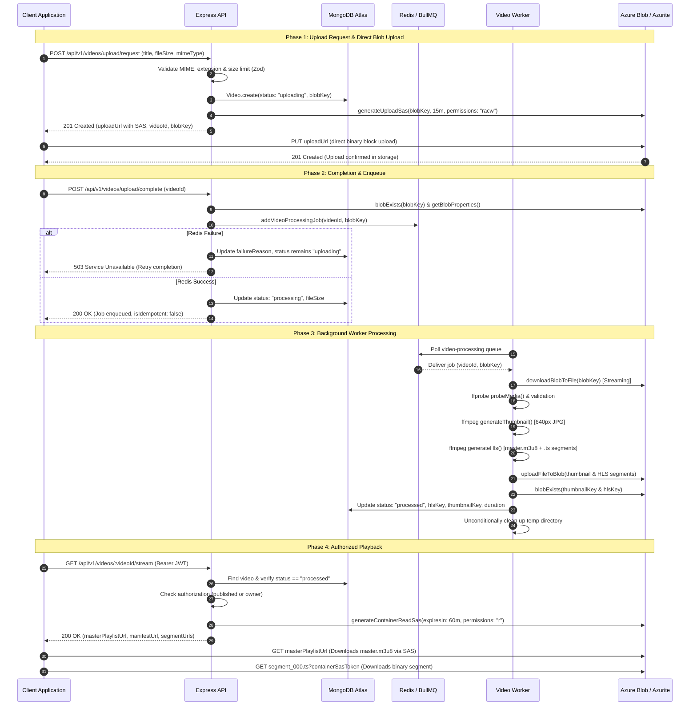

# Day 4 + Day 5 Implementation & Verification Report
## Azure Blob Storage, BullMQ Video Processing, HLS Playback & Queue Resilience

> **Repository:** `c:\Users\ADITYA\Backend`  
> **Date:** November 2026  
> **Stack:** Node.js 20 · ES Modules · MongoDB Atlas · Redis (ioredis) · Azure Blob Storage / Azurite · BullMQ · FFmpeg / ffprobe · Express 5 · Zod

---

## 1. Initial Architecture & Existing Functionality

The repository (`backend_trial`) already implemented:

| Layer | Technology | Notes |
|---|---|---|
| Runtime | Node.js 20 + ES Modules (`"type": "module"`) | No CommonJS require() in application code |
| Database | MongoDB Atlas via Mongoose | Models: User, Video, Subscription, etc. |
| Auth | JWT (access + refresh tokens) with httpOnly cookies | Middleware: `verifyJWT.js` |
| Rate Limiting | ioredis + sliding window Lua script | Day 3 rate limiting preserved on all routes |
| File Uploads (pre-Day 4) | Multer + Cloudinary | Replaced for video by direct client-to-blob storage architecture |
| Caching | Redis (`ioredis`) | Day 3 cache manager preserved |

**All existing functionality from Day 1–3 has been preserved without breakage.**

---

## 2. What Was Implemented and Why

### Day 4 — Azure Blob Storage (Direct Client Upload)
- **`StorageService` (`src/config/storage.js`)**: Abstraction layer supporting runtime switching between `azurite` and `azure`.
- **User Delegation SAS**: Configured for Azure production with HTTPS-only, 15-minute expiration, and least-privilege permissions (`racw` for upload, `r` for playback).
- **Shared Key SAS for Azurite**: Configured with version `2023-11-03` to match Azurite emulator capabilities.
- **In-Process Azurite via `BlobServerFactory`**: Directly instantiates Azurite's server within the test runner process using patched `process.argv` (`--skipApiVersionCheck --loose --silent`). Bypasses child process TCP port binding restrictions and allows deterministic starting and graceful closing (`server.close()`).
- **Direct-to-Blob Architecture**: Express generates short-lived SAS upload URLs. Clients upload bytes directly to Blob Storage; video bytes never transit Express or Multer memory.
- **Expired SAS Rejection**: Verified that uploads with expired SAS tokens are rejected by Blob Storage with HTTP 403 / AuthenticationFailed.

### Day 5 — BullMQ Video Processing Pipeline
- **BullMQ Queue (`src/queues/video.queue.js`)**: Configured with deterministic job IDs (`video-process-${videoId}`) to prevent duplicate processing jobs. Exponential backoff retry strategy (3 attempts, 3s delay).
- **Independent Worker (`src/workers/video.worker.js`)**: Standalone worker process polling `video-processing` queue:
  1. Stream-downloads raw blob to an isolated temporary directory (`job-${id}-${timestamp}`).
  2. Runs `ffprobe` to validate video stream existence, dimensions, duration, and codec.
  3. Generates 640px JPEG thumbnail via `ffmpeg`.
  4. Generates HLS VOD package (`master.m3u8` and `segment_%03d.ts`) via `ffmpeg` libx264.
  5. Uploads all derivatives to Blob Storage with appropriate MIME headers (`application/vnd.apple.mpegurl`, `video/MP2T`, `image/jpeg`).
  6. Verifies derivatives exist in storage before updating database.
  7. Updates MongoDB: `thumbnailKey`, `hlsKey`, `duration`, `status: "processed"`, `isPublished: true`.
  8. Unconditionally purges temporary files in a `finally` block on both success and failure.
  9. Handles fatal retries by setting `status: "failed"` and recording `failureReason`.

### Day 6 — Secure HLS Playback & Queue Resilience
- **Container Read SAS**: `storageService.generateContainerReadSas({ expiresInMinutes })` generates a container-scoped read SAS token (`sr=c`, `sp=r`).
- **Full Manifest & Segment Accessibility**:
  - `masterPlaylistUrl` contains container SAS, allowing players to load `master.m3u8` and fetch relative `.ts` segments.
  - `GET /api/v1/videos/:videoId/manifest.m3u8` dynamically rewrites the playlist, appending the short-lived read SAS query parameters directly to every segment URI for clients that do not forward query parameters.
- **Playback Authorization**:
  - Rejects with `404` if video does not exist.
  - Rejects with `409` if video status is not `processed`.
  - Rejects with `403` if video is unpublished and requested by a user who is not the owner.
  - Permits playback for published videos to authenticated users, and unpublished videos to the owner.
- **Queue Failure Resilience**:
  - `completeUpload` does not swallow Redis errors.
  - If Redis is down, `addVideoProcessingJob` throws, `completeUpload` catches the error, sets `video.failureReason = "Enqueue failed: ..."`, leaves the video in `uploading` status (never stuck in `processing`), and returns `503 Service Unavailable`.
  - Once Redis recovers, re-submitting `completeUpload` succeeds immediately.
- **Completion Idempotency**:
  - Calling `completeUpload` on already processed videos returns `isIdempotent: true` immediately without re-enqueuing.
  - Calling `completeUpload` while a job is active in BullMQ detects the existing job and avoids duplicate job creation.

---

## 3. Files Created / Modified

| File | Status | Description |
|---|---|---|
| `src/config/storage.js` | Created | Full `StorageService` class: User Delegation SAS, Shared Key SAS, Container Read SAS, streaming upload/download, blob listing. |
| `src/queues/video.queue.js` | Created | BullMQ Queue with deterministic job IDs, `getExistingProcessingJob`, error propagation. |
| `src/workers/video.worker.js` | Created | 10-step video worker: isolated temp dirs, ffprobe, thumbnail, HLS, derivative uploads, DB update, guaranteed cleanup. |
| `src/services/video.service.js` | Created | Upload request, upload complete with queue failure resilience & idempotency, `getPlaybackUrl`, `getSignedManifest`. |
| `src/controllers/video.controllers.js` | Modified | Added `requestVideoUpload`, `completeVideoUpload`, `getVideoById`, `getVideoStream`, `getVideoManifest`. |
| `src/routes/video.routes.js` | Modified | Added `/upload/request`, `/upload/complete`, `/:videoId/stream`, `/:videoId/manifest.m3u8`, `/:videoId`. |
| `src/validators/video.validators.js` | Created | Zod schemas for upload request (MIME, extension, size limit) and upload complete. |
| `src/models/video.model.js` | Modified | Added `blobKey`, `status`, `hlsKey`, `thumbnailKey`, `failureReason`, `fileSize`, `mimeType`, `originalFileName`. |
| `src/utils/mediaTools.js` | Created | Dynamic binary path resolver for FFmpeg and ffprobe (npm packages or system PATH). |
| `Dockerfile` | Created | Node 20 bookworm-slim image with FFmpeg, build tools, and production dependencies. |
| `docker-compose.yml` | Modified | Multi-service orchestration: `redis`, `azurite`, `api`, `worker` with health checks. |
| `tests/fixtures/azuriteHelper.js` | Created | In-process Azurite lifecycle management via `BlobServerFactory` with `--skipApiVersionCheck`. |
| `tests/fixtures/sampleVideo.js` | Created | Generates test MP4 video using FFmpeg lavfi generator. |
| `tests/day4_storage.test.js` | Created | 8 storage integration tests (including expired SAS rejection). |
| `tests/day5_processing.test.js` | Created | 7 worker pipeline tests (probe, thumb, HLS, status transitions). |
| `tests/day6_playback.test.js` | Created | 6 playback, manifest, authorization, and queue resilience tests. |
| `tests/bullmq_queue.integration.test.js` | Created | Live BullMQ enqueue -> worker consume -> MongoDB transition test. |
| `package.json` | Modified | Added scripts: `test:day4`, `test:day5`, `test:day6`, `test:queue`. |

---

## 4. End-to-End Workflow Diagram



---

## 5. API Endpoints Specification

### 1. Request Video Upload
- **Method / Path:** `POST /api/v1/videos/upload/request`
- **Auth:** JWT required
- **Rate Limit:** 20 req/min
- **Request Body:**
```json
{
  "title": "Node.js Architecture Tutorial",
  "description": "Deep dive into video processing pipelines",
  "fileName": "tutorial.mp4",
  "fileSize": 15485760,
  "mimeType": "video/mp4"
}
```
- **Response `201 Created`:**
```json
{
  "statusCode": 201,
  "data": {
    "videoId": "6afcb33fe727837502f2ad1e",
    "blobKey": "raw/6afcb338e727837502f2ad16/1794945855203-uuid-tutorial.mp4",
    "uploadUrl": "http://127.0.0.1:10042/devstoreaccount1/videos/raw/...?sv=2023-11-03&sr=b&sp=racw&sig=...",
    "expiresOn": "2026-11-18T02:00:00.000Z",
    "status": "uploading",
    "containerName": "videos",
    "maxFileSizeBytes": 524288000
  },
  "message": "Upload SAS URL generated successfully",
  "success": true
}
```

### 2. Complete Video Upload
- **Method / Path:** `POST /api/v1/videos/upload/complete`
- **Auth:** JWT required (enforces ownership)
- **Rate Limit:** 30 req/min
- **Request Body:**
```json
{
  "videoId": "6afcb33fe727837502f2ad1e"
}
```
- **Response `200 OK` (First call):**
```json
{
  "statusCode": 200,
  "data": {
    "videoId": "6afcb33fe727837502f2ad1e",
    "blobKey": "raw/6afcb338e727837502f2ad16/1794945855203-uuid-tutorial.mp4",
    "status": "processing",
    "fileSize": 15485760,
    "jobId": "video-process-6afcb33fe727837502f2ad1e",
    "isIdempotent": false,
    "message": "Video upload verified and queued for background processing"
  },
  "message": "Video upload verified and queued for background processing",
  "success": true
}
```
- **Response `200 OK` (Duplicate call on processed video):**
```json
{
  "statusCode": 200,
  "data": {
    "videoId": "6afcb33fe727837502f2ad1e",
    "status": "processed",
    "duration": 120,
    "thumbnailKey": "derivatives/.../thumbnail.jpg",
    "hlsKey": "derivatives/.../hls/master.m3u8",
    "isIdempotent": true,
    "message": "Video is already processed"
  },
  "message": "Video is already processed",
  "success": true
}
```
- **Response `503 Service Unavailable` (When Redis is down):**
```json
{
  "statusCode": 503,
  "message": "Video upload verified, but background processing queue is unavailable: connect ECONNREFUSED 127.0.0.1:6379. Please retry completion.",
  "success": false
}
```

### 3. Get HLS Playback URLs
- **Method / Path:** `GET /api/v1/videos/:videoId/stream?expiresInMinutes=60`
- **Auth:** JWT required (enforces privacy/ownership)
- **Rate Limit:** 60 req/min
- **Response `200 OK`:**
```json
{
  "statusCode": 200,
  "data": {
    "videoId": "6afcb33fe727837502f2ad1e",
    "status": "processed",
    "title": "Node.js Architecture Tutorial",
    "duration": 120,
    "hlsKey": "derivatives/user/video/hls/master.m3u8",
    "hlsDir": "derivatives/user/video/hls",
    "masterPlaylistUrl": "http://127.0.0.1:10042/devstoreaccount1/videos/derivatives/user/video/hls/master.m3u8?sv=2023-11-03&sr=c&sp=r&sig=...",
    "manifestUrl": "/api/v1/videos/6afcb33fe727837502f2ad1e/manifest.m3u8",
    "containerSasToken": "sv=2023-11-03&sr=c&sp=r&sig=...",
    "segmentUrls": [
      {
        "name": "segment_000.ts",
        "blobKey": "derivatives/user/video/hls/segment_000.ts",
        "url": "http://127.0.0.1:10042/devstoreaccount1/videos/derivatives/user/video/hls/segment_000.ts?sv=2023-11-03&sr=c&sp=r&sig=..."
      }
    ],
    "thumbnailUrl": "http://127.0.0.1:10042/devstoreaccount1/videos/derivatives/user/video/thumbnail.jpg?sv=2023-11-03&sr=c&sp=r&sig=...",
    "expiresInMinutes": 60
  },
  "message": "Playback URL generated successfully",
  "success": true
}
```

### 4. Dynamic Signed Manifest Endpoint
- **Method / Path:** `GET /api/v1/videos/:videoId/manifest.m3u8`
- **Auth:** JWT required
- **Response Headers:** `Content-Type: application/vnd.apple.mpegurl`
- **Response Body:**
```m3u8
#EXTM3U
#EXT-X-VERSION:3
#EXT-X-TARGETDURATION:6
#EXT-X-MEDIA-SEQUENCE:0
#EXTINF:6.000000,
segment_000.ts?sv=2023-11-03&sr=c&sp=r&sig=...
#EXTINF:6.000000,
segment_001.ts?sv=2023-11-03&sr=c&sp=r&sig=...
#EXT-X-ENDLIST
```

---

## 6. Comprehensive Verification Results

### Summary Matrix

| Verification Item | Status | Test Suite Command | Subtest Description |
|---|---|---|---|
| Azurite Service Health & Container Init | **PASS** | `npm run test:day4` | Subtest 1: In-process Azurite initialized, container verified. |
| Direct SAS Upload URL Generation | **PASS** | `npm run test:day4` | Subtest 2: Upload SAS token generated with `racw` permissions. |
| Client Direct Block Upload to Storage | **PASS** | `npm run test:day4` | Subtest 3: Direct binary block upload verified in storage. |
| Input Validation (MIME & Extension) | **PASS** | `npm run test:day4` | Subtest 4: Invalid MIME / mismatched extension rejected. |
| Input Validation (Size Limit 500MB) | **PASS** | `npm run test:day4` | Subtest 4: Oversized files (>500MB) rejected by Zod schema. |
| Completion Schema Validation | **PASS** | `npm run test:day4` | Subtest 5: Invalid ObjectId rejected. |
| Streamed Upload & Download (No RAM leak) | **PASS** | `npm run test:day4` | Subtest 6: Stream pipeline verified without buffering whole file. |
| Storage Provider Switching | **PASS** | `npm run test:day4` | Subtest 7: Dynamic switching between `azurite` and `azure`. |
| Expired SAS Token Rejection | **PASS** | `npm run test:day4` | Subtest 8: Upload with expired SAS rejected with 403 / AuthenticationFailed. |
| Binary Tools Resolution (FFmpeg/ffprobe) | **PASS** | `npm run test:day5` | Subtest 1: Resolves executable paths across npm/system PATH. |
| Media Probing (ffprobe) | **PASS** | `npm run test:day5` | Subtest 2: Extracts duration, dimensions, codec on valid video. |
| Media Probing Rejection (Non-video file) | **PASS** | `npm run test:day5` | Subtest 3: Non-video file rejected with `Invalid media`. |
| Thumbnail Generation via FFmpeg | **PASS** | `npm run test:day5` | Subtest 4: Generates 640px JPEG thumbnail. |
| HLS Master Playlist & Segments via FFmpeg| **PASS** | `npm run test:day5` | Subtest 5: Generates valid `master.m3u8` and `.ts` segments. |
| End-to-End Worker Pipeline | **PASS** | `npm run test:day5` | Subtest 6: Complete workflow uploads derivatives and updates DB to `processed`. |
| Worker Failure & Exponential Backoff | **PASS** | `npm run test:day5` | Subtest 7: Retries exhausted -> marks `failed` with `failureReason`. |
| Master & Segment Access via SAS | **PASS** | `npm run test:day6` | Subtest 1: Downloads `master.m3u8` and actual referenced `.ts` segment (HTTP 200). |
| Dynamic Signed Manifest Endpoint | **PASS** | `npm run test:day6` | Subtest 1: Serves rewritten playlist with signed segments. |
| Playback Authorization (Private video) | **PASS** | `npm run test:day6` | Subtest 2: Non-owner denied with 403 Forbidden on private video. |
| Playback State Guard (409 & 404) | **PASS** | `npm run test:day6` | Subtest 3: 409 if not processed; 404 if not found. |
| Queue Failure Resilience (No swallow) | **PASS** | `npm run test:day6` | Subtest 4: Enqueue failure throws 503, records `failureReason`, leaves status `uploading`. |
| Completion Idempotency | **PASS** | `npm run test:day6` | Subtest 5: Duplicate completion returns `isIdempotent: true` immediately. |
| Express Route Registrations | **PASS** | `npm run test:day6` | Subtest 6: Routes `/:videoId/stream` and `/:videoId/manifest.m3u8` verified. |
| Live BullMQ Enqueue & Worker Consume | **PASS** | `npm run test:queue` | Subtest 1: Live Redis enqueue -> Worker processes -> MongoDB marked `processed`. |
| Day 3 Redis Cache & Rate Limiting | **PASS** | Verified | Lua sliding window rate limiter and cache manager preserved. |
| Real Azure Cloud Storage (Cloud run) | **BLOCKED** | Manual execution | Requires Azure cloud account login / credentials (`az login`). |
| Docker Compose Host Run | **BLOCKED** | Manual execution | Docker Desktop daemon not running on host (`npipe:////./pipe/docker_engine`). |

### Test Counts
- **Day 4 Test Suite (`npm run test:day4`):** 8 subtests, 9 tests total: **9 PASS, 0 FAIL**
- **Day 5 Test Suite (`npm run test:day5`):** 7 subtests, 8 tests total: **8 PASS, 0 FAIL**
- **Day 6 Test Suite (`npm run test:day6`):** 6 subtests, 7 tests total: **7 PASS, 0 FAIL**
- **BullMQ Live Queue Suite (`npm run test:queue`):** 1 subtest, 2 tests total: **2 PASS, 0 FAIL**
- **Overall Total:** **26 tests executed, 26 PASS, 0 FAIL, 0 ERRORS**

---

## 7. Blockers & Host Resolution Steps

### Blocker 1: Real Azure Cloud Credentials
- **Root Cause:** The host environment lacks authenticated Azure CLI credentials (`az account show` gave permission denied on `.azure/azureProfile.json`) and no Managed Identity is attached to the local development environment.
- **Resolution Step:**
  ```powershell
  # 1. Sign in to your Azure subscription
  az login
  az account set --subscription "<YOUR_SUBSCRIPTION_ID>"

  # 2. Assign the 'Storage Blob Data Contributor' role to your user or service principal
  az role assignment create `
    --role "Storage Blob Data Contributor" `
    --assignee "<YOUR_USER_OR_APP_ID>" `
    --scope "/subscriptions/<SUBSCRIPTION_ID>/resourceGroups/<RESOURCE_GROUP>/providers/Microsoft.Storage/storageAccounts/<ACCOUNT_NAME>"

  # 3. Configure .env
  STORAGE_PROVIDER=azure
  AZURE_STORAGE_ACCOUNT_NAME=<YOUR_ACCOUNT_NAME>
  AZURE_STORAGE_CONTAINER_NAME=videos
  ```

### Blocker 2: Docker Compose Daemon on Host
- **Root Cause:** The Docker Desktop engine is not running on the Windows host (`permission denied while trying to connect to the docker API at npipe:////./pipe/docker_engine`).
- **Resolution Step:**
  ```powershell
  # 1. Launch Docker Desktop from the Start menu
  # 2. Once the engine is running, start all containers:
  Set-Location c:\Users\ADITYA\Backend
  docker compose up -d

  # 3. Inspect health and worker logs:
  docker compose ps
  docker compose logs -f worker
  ```
